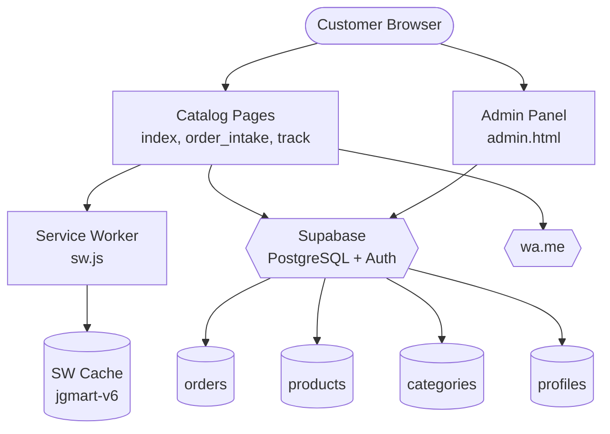

# JG Mart — Getting Started

JG Mart is a static, single-page progressive web app (PWA) for hyperlocal grocery delivery in Japan Garden City, Dhaka. It has no server — the frontend is a collection of vanilla HTML/CSS/JS files deployed to Vercel, with Supabase (PostgreSQL + Auth) as the backend.

## Key Concepts

- **WhatsApp-first ordering** — customers build a cart in the browser and submit via a WhatsApp message link; no account or app download required.
- **Supabase as backend** — product catalog, orders, and admin auth live in Supabase; the client uses the public anon key to read products and submit orders.
- **Offline-first PWA** — a service worker caches the catalog and core pages so the shop works without a network connection, with an offline queue for orders.
- **Zone-based delivery** — the neighborhood is split into 4 clusters with per-cluster delivery fees (free for clusters 1 & 2, ৳20 for cluster 3, ৳30 for cluster 4).

## Entry Points

- [`src/web/catalog/index.html`](https://github.com/FahadIbrahim93/jgmart-hermes/blob/main/src/web/catalog/index.html) — main catalog shop (1,602 lines).
- [`src/web/catalog/order_intake.html`](https://github.com/FahadIbrahim93/jgmart-hermes/blob/main/src/web/catalog/order_intake.html) — WhatsApp order form (880 lines).
- [`src/web/catalog/admin.html`](https://github.com/FahadIbrahim93/jgmart-hermes/blob/main/src/web/catalog/admin.html) — admin panel (1,222 lines).
- [`src/web/catalog/track.html`](https://github.com/FahadIbrahim93/jgmart-hermes/blob/main/src/web/catalog/track.html) — order tracking.
- [`src/web/catalog/notify.html`](https://github.com/FahadIbrahim93/jgmart-hermes/blob/main/src/web/catalog/notify.html) — WhatsApp notification templates.

## High-Level Architecture

The app is a static site. Vercel serves the HTML/CSS/JS/JSON files. The browser talks directly to Supabase over HTTPS using the public anon key. There is no application server, no API gateway, and no CDN edge logic — just a flat file tree.

See [modules](modules/) for per-module detail.

## System Diagram

## Data Flow

1. **Catalog load** — [`db.js:loadProductsFromDB`](https://github.com/FahadIbrahim93/jgmart-hermes/blob/main/src/web/catalog/db.js) fetches products from Supabase (`products` table, `in_stock = true`), falling back to [`catalog_data.json`](https://github.com/FahadIbrahim93/jgmart-hermes/blob/main/src/web/catalog/catalog_data.json) if Supabase is unreachable.
2. **Cart** — [`order-state.js`](https://github.com/FahadIbrahim93/jgmart-hermes/blob/main/src/web/catalog/order-state.js) manages order status transitions; cart state lives in `localStorage` (`jgmart_c`).
3. **Order submission** — [`db.js:submitOrder`](https://github.com/FahadIbrahim93/jgmart-hermes/blob/main/src/web/catalog/db.js) calls the `create_public_order` RPC (a `SECURITY DEFINER` function) to insert the order into Supabase, then saves a copy to `localStorage`.
4. **Offline** — [`sw.js`](https://github.com/FahadIbrahim93/jgmart-hermes/blob/main/src/web/catalog/sw.js) caches the catalog pages; [`offline-queue.js`](https://github.com/FahadIbrahim93/jgmart-hermes/blob/main/src/web/catalog/offline-queue.js) queues orders when the network is down.

## Key Design Decisions

- **No build step.** The site is plain HTML/CSS/JS served as static files. This keeps deployment trivial (Vercel Git Integration) and avoids a build pipeline, but means every page re-implements its own cart/nav/i18n logic rather than sharing components.
- **Supabase anon key in the client.** The public key is embedded in the source (in `config.js` placeholders, overridden at runtime by `config.runtime.js` in production). This is correct for a publishable key — it's needed to read the catalog and submit orders — but it means anyone can call the order RPC directly.
- **`SECURITY DEFINER` RPC for orders.** The `create_public_order` function runs with the definer's privileges, which is what lets an unauthenticated (anon) client insert into the `orders` table despite RLS. The permissive RLS policy on `orders`/`order_items` (allowing `anon` INSERT) is the defense-in-depth layer.
- **Three sources of truth for products.** Product data lives in Supabase (authoritative), `catalog_data.json` (static fallback), and `localStorage` (cart state). They are reconciled at runtime via `resolveProductUuid`'s legacy-id-to-UUID mapping. This works but is migration debt — a process that updates one without the others silently desyncs price/stock.
- **CSP with a nonce.** Pages use a Content-Security-Policy with `script-src 'nonce-gscb6Xp2nALPgenhRE7XtA' 'unsafe-inline'`. The nonce is static in the source (not per-request), which is a known CSP weakness — it means any injected script with the same nonce is allowed.

## Modules

| Module | Purpose |
|---|---|
| [`modules/catalog.md`](modules/catalog.md) | Catalog pages, product display, cart UI |
| [`modules/orders.md`](modules/orders.md) | Order submission, tracking, offline queue |
| [`modules/admin.md`](modules/admin.md) | Admin panel, auth, order management |
| [`modules/data.md`](modules/data.md) | Supabase integration, data models, RLS |
| [`modules/pwa.md`](modules/pwa.md) | Service worker, offline caching, manifest |
| [`modules/security.md`](modules/security.md) | Sanitization, validation, CSP, auth |